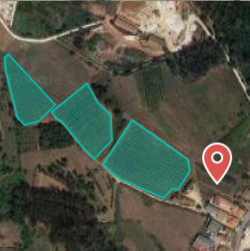

### Render static maps

This small package allows you to render static maps easly.

It uses svg to render the tiles and the vectors for the Polygon. You can specify a bounding box or if you pass any shape, it will automatically find the bounds for the shapes you want to add.



## Packages

- [*] @staticmaps/core
- [ ] @staticmaps/svelte
- [*] @staticmaps/react
- [ ] @staticmaps/vue
- [ ] @staticmaps/node

## Development

This is a pnpm workspace driven by [Vite+](https://viteplus.dev). Use Node 24 LTS (pinned in
`.node-version`) and pnpm 12.

```bash
pnpm install
pnpm build        # vp run -r build (core, react, vue, svelte)
pnpm test         # builds core, then runs the Vitest suites
pnpm test:e2e     # builds the Svelte demo and runs Playwright
pnpm exec vp check
```

The demos and type checks import `@staticmaps/core` from its `dist`, and the package dev scripts build it
first. Run `pnpm build` once after cloning if you use other commands directly.

Libraries are **ESM-only** (`dist/index.js` + `dist/index.d.ts`). There are no CommonJS, UMD, or
IIFE builds, so `require()` and `<script>` global usage are no longer supported. This is a
breaking change for consumers that relied on those formats.
